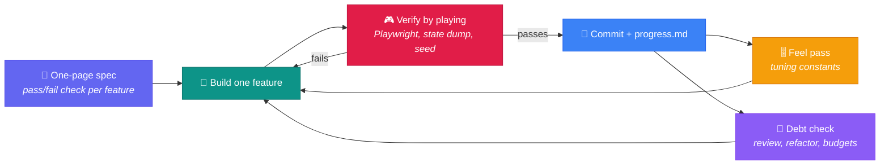
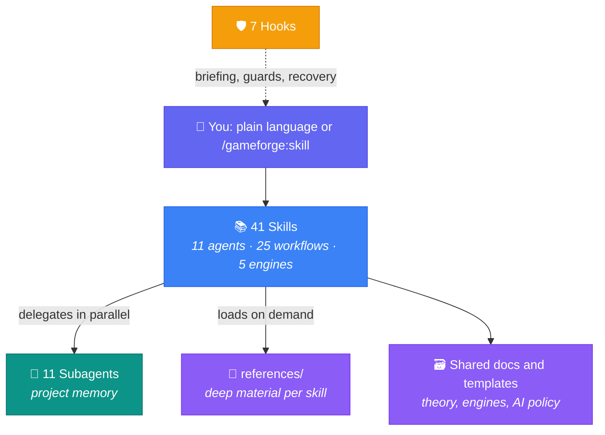

<div align="center">


<br>

<a href="skills/"></a>
<a href="agents/"></a>
<a href="https://code.claude.com/docs/en/plugins"></a>
<a href="LICENSE"></a>

<br>

<a href="https://github.com/AlterLab-IEU/AlterLab_GameForge/stargazers"></a>
<a href="https://github.com/AlterLab-IEU/AlterLab_GameForge/actions/workflows/validate-skills.yml"></a>
<a href="CONTRIBUTING.md"></a>
<a href="CHANGELOG.md"></a>
<a href="https://github.com/BehiSecc/awesome-claude-skills"></a>

<br>

> 📢 **Featured in** [awesome-claude-skills](https://github.com/BehiSecc/awesome-claude-skills)

<br><br>

<h3>🎮 A full indie game studio inside Claude Code</h3>

<p><em>Eleven studio roles, guided workflows from first idea to launch day, and engine specialists for Godot, Unity, Unreal, Three.js and 2D web, built for the way games are made in 2026: with AI agents, verified at every step.</em></p>

<p>
<a href="#-quick-start"><b>Install »</b></a> ·
<a href="#-where-do-i-start">Where Do I Start?</a> ·
<a href="#-skill-catalog">Skill Catalog</a> ·
<a href="#-building-games-with-ai-agents">Building with AI Agents</a> ·
<a href="CHANGELOG.md">What's New</a>
</p>

<br>

<hr>

<table><tr><td>

<b>Built by</b> <a href="https://github.com/AlterLab-IEU"><b>AlterLab Creative Technologies Laboratory</b></a>, Izmir University of Economics

</td></tr></table>

</div>

<br>

<div align="center">
<table>
<tr>
<td align="center" width="25%">
<h3>🎬</h3>
<h3>A Studio, Not a Chatbot</h3>
<p>Eleven roles with real decision<br>authority, running inline or as<br>parallel subagents with memory</p>
</td>
<td align="center" width="25%">
<h3>⚡</h3>
<h3>Built for AI Agents</h3>
<p>A disciplined vibe-coding loop:<br>spec, build, verify, commit.<br>Playable tonight, sane on Monday</p>
</td>
<td align="center" width="25%">
<h3>🎯</h3>
<h3>Five Engines, Current</h3>
<p>Godot 4.7, Unity 6.3 LTS,<br>Unreal 5.8, Three.js r187,<br>Phaser 4, with agent pitfalls flagged</p>
</td>
<td align="center" width="25%">
<h3>🛡️</h3>
<h3>Production-Safe</h3>
<p>Hooks guard engine files and<br>Git LFS; launch skills check AI<br>disclosure and accessibility law</p>
</td>
</tr>
</table>
</div>

<br>

## 📋 Table of Contents

<details open>
<summary><b>Click to expand / collapse</b></summary>

<br>

- [🆕 What's New in v3.0](#-whats-new-in-v30)
- [🚀 Quick Start](#-quick-start)
- [🧭 Where Do I Start?](#-where-do-i-start)
- [📚 Skill Catalog](#-skill-catalog)
- [⚡ Building Games with AI Agents](#-building-games-with-ai-agents)
- [⚙️ How GameForge Works](#%EF%B8%8F-how-gameforge-works)
- [🎯 Engine Coverage](#-engine-coverage)
- [🛠️ Setting Up Your Game Project](#%EF%B8%8F-setting-up-your-game-project)
- [📦 Genre Packs](#-genre-packs)
- [✅ Quality and Validation](#-quality-and-validation)
- [🗂️ Project Structure](#%EF%B8%8F-project-structure)
- [🤝 Contributing](#-contributing)

</details>

<br>

## 🆕 What's New in v3.0

v3.0 is a rebuild. GameForge now installs as a real Claude Code plugin, every skill was rewritten
against a shared spec and current research, and the web and AI-agent paths are first-class.

| | Change | Details |
|:---:|:---|:---|
| 🔌 | **Installs as a plugin** | Spec-compliant `.claude-plugin/` manifests. The old `claude install github:…` line reinstalled the Claude Code CLI rather than GameForge; see [Quick Start](#-quick-start) |
| ⚡ | **7 new skills** | `game-vibe-code`, `game-ai-assets`, `game-web-publish`, `game-multiplayer`, `game-help`, and engine specialists for **Three.js / R3F** and **2D web** |
| 🧠 | **Studio subagents** | The 11 roles run as parallel subagents with project memory; the orchestrator delegates to them for independent reviews |
| 🔬 | **Every skill upgraded** | Late-2026 engines and tools, an AI-agent section per role, unsourced anecdotes removed, deep material moved to on-demand `references/` |
| 🛡️ | **Hooks that work** | Rewritten, wired and tested: session briefings, compaction recovery, commit and Git LFS guards, engine-file protection. Silent outside game projects |
| ✅ | **Real validation** | A plugin-aware validator, 183 hook tests on Linux, macOS and Windows, and `claude plugin validate --strict` in CI |

Full details: [CHANGELOG.md](CHANGELOG.md).

<br>

## 🚀 Quick Start

**1. Install** (Claude Code 2.1.275 or later):

```
/plugin install gameforge --marketplace AlterLab-IEU/AlterLab_GameForge
```

<details>
<summary>Two-step install, shell install, or local development</summary>

<br>

```
/plugin marketplace add AlterLab-IEU/AlterLab_GameForge
/plugin install gameforge@alterlab-gameforge
```

```bash
claude plugin marketplace add AlterLab-IEU/AlterLab_GameForge
claude plugin install gameforge@alterlab-gameforge
```

```bash
git clone https://github.com/AlterLab-IEU/AlterLab_GameForge.git
claude --plugin-dir ./AlterLab_GameForge
```

</details>

**2. Ask for directions.** In any folder:

```
/gameforge:game-help
```

**3. Set up a game project.** In your game's repository:

```
/gameforge:game-start
```

This writes `.gameforge/project.json`, copies the right engine starter into `CLAUDE.md`, sets up
Git LFS, and turns on GameForge's session briefings. From then on, plain language works:
"design the parry system", "why is my Godot export black on iOS", "plan the next sprint".

> [!TIP]
> Commit `starters/claude-config/settings.json` as `.claude/settings.json` in your game repo, and
> teammates who open it in Claude Code are prompted to install GameForge.

<br>

## 🧭 Where Do I Start?

| Your situation | Run | What you get |
|:---|:---|:---|
| "Just an itch of an idea" | `/gameforge:game-brainstorm` | Original concepts, scored, with a core loop each |
| "I want something playable tonight" | `/gameforge:game-vibe-code` | Spec, scaffold, verified build loop, git checkpoints |
| "Starting a real project" | `/gameforge:game-start` | Project config, engine starter, LFS, pillars, milestones |
| "Game jam this weekend" | `/gameforge:game-jam-mode` | Theme analysis, scope lock, hour-by-hour plan |
| "I have code but no docs" | `/gameforge:game-reverse-document` | Design and architecture docs recovered from code |
| "Review what the agent just wrote" | `/gameforge:game-code-review` | Severity-ranked findings, outdated APIs flagged |
| "Planning the next sprint" | `/gameforge:game-sprint-plan` | Tasks with review time budgeted, risks, velocity |
| "I need art and audio fast" | `/gameforge:game-ai-assets` | Consistent assets, licence checks, provenance log |
| "Adding online play" | `/gameforge:game-multiplayer` | Topology, sync model and anti-cheat for your engine |
| "Shipping a browser game" | `/gameforge:game-web-publish` | itch.io and portal builds, size budgets, disclosures |
| "Preparing a Steam launch" | `/gameforge:game-launch` | Store page, builds, compliance checklist, launch week |
| "Not sure" | `/gameforge:game-help` | One recommendation based on your project's state |

Walkthroughs: [docs/workflow-examples.md](docs/workflow-examples.md) · Lifecycle map:
[docs/workflow-guide.md](docs/workflow-guide.md)

<br>

## 📚 Skill Catalog

Invoke any skill as `/gameforge:<name>`, or just describe what you need.

### 🎬 Studio Agents (11)

Roles you consult. Each also runs as a subagent (`gameforge:<name>`) with project memory.

| Skill | Role | Decides |
|:---|:---|:---|
| `game-creative-director` | Creative Director | Vision, pillars, tone, AI-use stance, creative conflicts |
| `game-technical-director` | Technical Director | Engine, architecture, performance budgets, agent/MCP security |
| `game-producer` | Producer | Scope, schedule, milestones, risk, cross-domain trade-offs |
| `game-designer` | Game Designer | Mechanics, systems, progression, tuning |
| `game-economy-designer` | Economy Designer | Currencies, sinks and faucets, pricing, monetization ethics |
| `game-narrative-director` | Narrative Director | Story, characters, dialogue, lore |
| `game-art-director` | Art Director | Visual style, art bible, asset pipeline, AI-asset policy |
| `game-audio-director` | Audio Director | Music, SFX, adaptive audio, mix, voice rights |
| `game-qa-lead` | QA Lead | Test strategy, automation, bugs, release gates |
| `game-ux-designer` | UX Designer | Onboarding, HUD, menus, usability |
| `game-accessibility-specialist` | Accessibility Specialist | Inclusive design, accommodations, EAA compliance |

### 🔧 Workflows (25)

Guided processes with a defined output.

| Phase | Skills |
|:---|:---|
| **Orientation** | `game-help` |
| **Ideation** | `game-brainstorm`, `game-market-research` |
| **Pre-production** | `game-start`, `game-gdd-author`, `game-design-review`, `game-scope-check` |
| **Building** | `game-prototype`, `game-vibe-code`, `game-jam-mode`, `game-ai-assets`, `game-multiplayer` |
| **Production** | `game-sprint-plan`, `game-team-orchestrator`, `game-code-review`, `game-reverse-document`, `game-ci-pipeline`, `game-localization-manager`, `game-analytics-setup` |
| **Tuning and testing** | `game-balance-check`, `game-playtest` |
| **Release** | `game-launch`, `game-web-publish` |
| **Reflection** | `game-retrospective`, `game-postmortem` |

### 🎯 Engine Specialists (5)

| Skill | Engine | Covers |
|:---|:---|:---|
| `game-godot-specialist` | Godot 4.7 / 4.8 | GDScript and C#, scenes and signals, resources, exports incl. web, headless testing |
| `game-unity-specialist` | Unity 6.3 LTS / 6.6 | C#, URP/HDRP, Addressables, Input System, DOTS, Unity AI and MCP |
| `game-unreal-specialist` | Unreal Engine 5.8 | C++ and Blueprints, GAS, Enhanced Input, Nanite/Lumen budgets, editor scripting |
| `game-threejs-specialist` | Three.js r187 / React Three Fiber | WebGL and WebGPU/TSL, Rapier, glTF pipeline, mobile-web performance |
| `game-web2d-specialist` | Phaser 4, PixiJS 8, Kaplay, Excalibur | Scenes, physics, tilemaps, atlases, portal-ready builds |

<br>

## ⚡ Building Games with AI Agents

Most new indie and jam games now involve a coding agent somewhere. GameForge treats that as a craft
with rules, not a slot machine. The rules come from what worked in 2025-2026 jams and from
published agent guidance, and they are written up in [docs/vibe-coding.md](docs/vibe-coding.md).



- **Every step ends in a check.** The agent proves a feature works by playing it, not by saying so.
- **Original games only.** GameForge turns "make a clone of X" into an original design that keeps
  the mechanic you love. Claude Code declines recreations of existing games, and stores remove them.
- **Every generated asset is logged.** Disclosures for Steam, itch.io and the EU AI Act are drafted
  from the log, not reconstructed the night before launch.
- **Agents get current APIs.** Engine specialists list the deprecated patterns agents still produce
  (Godot 3 syntax, Three.js `PostProcessing`, Phaser 3 pipelines) next to their replacements.

<br>

## ⚙️ How GameForge Works



**Skills load progressively.** Claude always sees each skill's short description, loads the full skill
only when it is used, and reads a skill's `references/` files only when that part of the work needs
them. `claude plugin details gameforge` shows the token cost of every component.

**Subagents keep a memory.** `/gameforge:game-team-orchestrator` sends a design review to the
Creative Director, Game Designer, Technical Director and Producer at once, each in its own context,
and synthesizes their reports. Each role remembers what it decided in this project.

**Hooks stay out of the way.** Outside a game project they do nothing. Inside one:

| Hook | Does |
|:---|:---|
| Session start | Briefs Claude: engine and version, phase, git state, your saved focus, gaps |
| Pre-compact | Snapshots state, restored automatically after compaction |
| `git commit` guard | Blocks binaries over 20 MB that Git LFS is not tracking; checks commit messages once you opt in |
| Engine-file guard | Blocks edits to `.godot/`, Unity `Library/`, Unreal `Intermediate/` and `.uasset`; asks before `.meta` |
| Subagents, failures, session end | Delegation log, parallelism warning, recovery note after API errors |

Reference and opt-outs: [docs/hooks.md](docs/hooks.md).

<br>

## 🎯 Engine Coverage

| Engine | Versions covered | Agent integration notes |
|:---|:---|:---|
| **Godot** | 4.7.2 stable, 4.8 beta | No official MCP server; community servers listed with security notes |
| **Unity** | 6.3 LTS, 6.6, 7.0 alpha notes | Unity AI, official MCP server and Claude Code plugin |
| **Unreal Engine** | 5.8, UE6 planning notes | Experimental editor-only MCP plugin; Python editor scripting |
| **Three.js / R3F** | r187, R3F 9 (10 alpha notes) | WebGL default, WebGPU/TSL opt-in; deprecated-API table for agents |
| **2D web** | Phaser 4, PixiJS 8, Kaplay, Excalibur | Phaser 3 to 4 migration table for agents |

Comparison and selection guidance: [docs/engine-comparison.md](docs/engine-comparison.md) ·
Agent and MCP setup: [docs/mcp-integrations.md](docs/mcp-integrations.md)

<br>

## 🛠️ Setting Up Your Game Project

`/gameforge:game-start` does this for you. To do it by hand, copy one starter into your game repo
as `CLAUDE.md`:

| Starter | For |
|:---|:---|
| [`starters/godot/`](starters/godot/CLAUDE.md) | Godot 4 projects |
| [`starters/unity/`](starters/unity/CLAUDE.md) | Unity 6 projects |
| [`starters/unreal/`](starters/unreal/CLAUDE.md) | Unreal Engine 5 projects |
| [`starters/threejs/`](starters/threejs/CLAUDE.md) | Three.js / React Three Fiber with Vite |
| [`starters/web2d/`](starters/web2d/CLAUDE.md) | Phaser / PixiJS / Kaplay with Vite |
| [`starters/claude-config/`](starters/claude-config/) | Engine-neutral `CLAUDE.md` and a `settings.json` with safe permissions and the GameForge marketplace |

Details: [starters/README.md](starters/README.md)

<br>

## 📦 Genre Packs

Reference material that skills load when your project's genre matches: design patterns grounded in
shipped games, balance templates and ideation prompts.

| Pack | Covers |
|:---|:---|
| [**Roguelike**](genre-packs/roguelike/) | Run structure, permadeath, procedural generation, meta-progression, synergy systems, Monte Carlo balance validation |
| [**Narrative**](genre-packs/narrative/) | Branching architecture, choice design, dialogue systems, consequence modeling, environmental storytelling |

Write your own: [docs/genre-pack-spec.md](docs/genre-pack-spec.md)

<br>

## ✅ Quality and Validation

Every change runs three gates in CI:

| Gate | Checks |
|:---|:---|
| `python3 scripts/validate.py` | Manifests and versions, documented frontmatter only, no unscoped `Bash` pre-approval, fork rules, size caps, every path and cross-skill reference resolves, doc links, counts quoted in docs |
| `bash tests/hooks.test.sh` | 183 hook tests on Linux, macOS and Windows, every engine fixture, under `jq`, `python3` and the `sed` fallback |
| `claude plugin validate . --strict` | Claude Code's own manifest and component validation |

Content is held to the [skill quality rubric](docs/skill-quality-rubric.md): versions and policies are
dated and sourced, claims about real games are public record, code is correct for the versions it
names, and every skill ends in a concrete output template.

<br>

## 🗂️ Project Structure

```
AlterLab_GameForge/
├── .claude-plugin/         # plugin.json, marketplace.json, icon
├── skills/
│   ├── agents/             # 11 studio agent skills
│   ├── workflows/          # 25 workflow skills
│   └── engine-specialists/ # 5 engine specialists
├── agents/                 # 11 studio subagents (project memory)
├── hooks/                  # hooks.json + 7 POSIX sh hooks
├── docs/                   # 17 shared knowledge-base documents
├── templates/              # 21 document templates
├── genre-packs/            # roguelike, narrative
├── starters/               # per-engine CLAUDE.md + team settings.json
├── scripts/validate.py     # repository validator
└── tests/hooks.test.sh     # hook test suite
```

<br>

## 🔗 Sister Projects

- [AlterLab-FC-Skills](https://github.com/AlterLab-IEU/AlterLab-FC-Skills): skills for communication students
- [AlterLab-Academic-Skills](https://github.com/AlterLab-IEU/AlterLab-Academic-Skills): evaluated academic research skills

## 🤝 Contributing

Contributions are welcome: sharper skills, new genre packs, engine updates, bug reports. Read
[CONTRIBUTING.md](CONTRIBUTING.md), then run the three checks above before opening a pull request.

## 📜 License

[MIT](LICENSE) © 2026 AlterLab Creative Technologies Laboratory

<br>

<div align="center">

<b>Built with ❤️ by <a href="https://github.com/AlterLab-IEU">AlterLab Creative Technologies Laboratory</a></b>

<br><br>

<b>41 skills · 11 subagents · 5 engines · one studio</b>

<br><br>

<sub>If GameForge helps you ship, consider giving it a ⭐</sub>
<br>
<a href="#">⬆ Back to Top</a>

</div>

<br>


